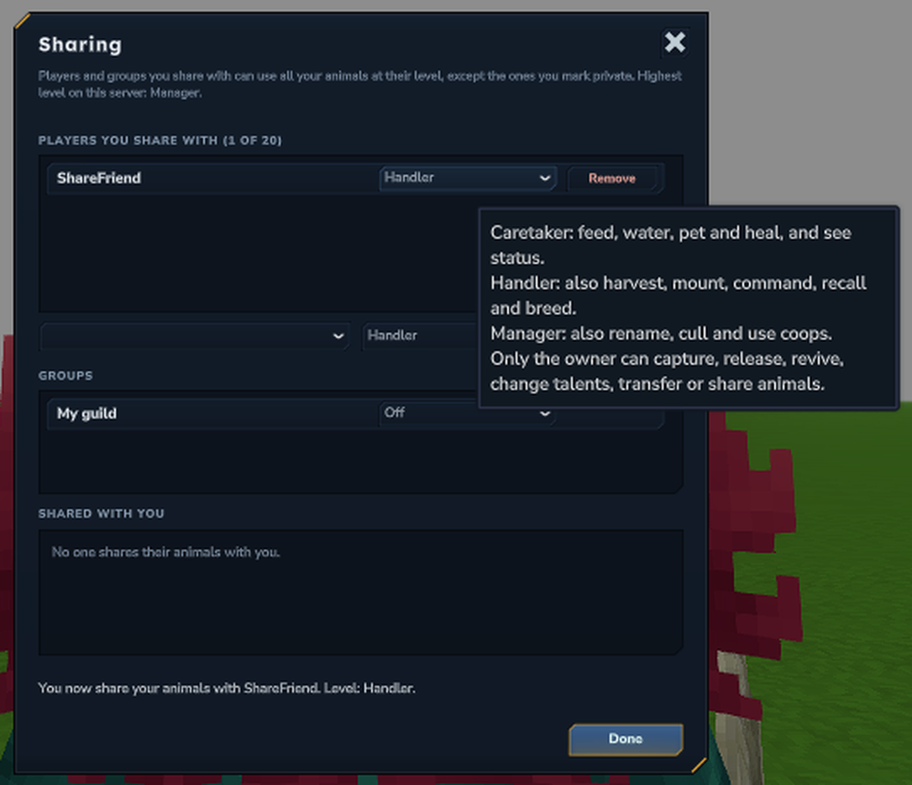
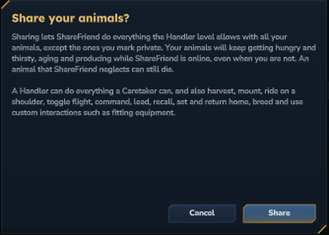
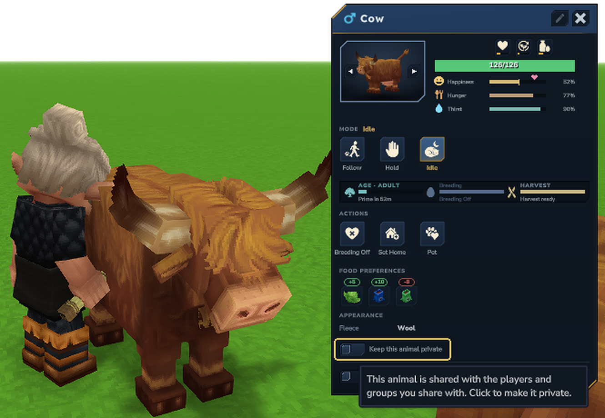
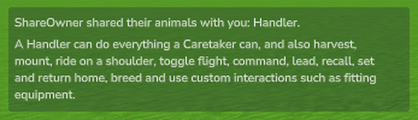
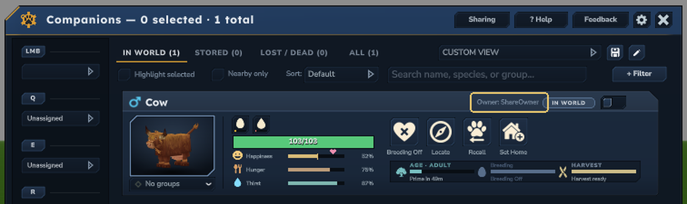

# Sharing Your Animals

Parent: [Gameplay Guides Index](/mod/alecs-animal-husbandry/gameplay-guides-index) | [Home](/mod/alecs-animal-husbandry/)

Let friends help with your farm: feed your livestock, milk your cows, ride your mounts or manage your herd, while you
stay the only owner. Sharing never gives an animal away, and your animal limits still count it as yours.

Sharing needs Tamework 5.11.0 or newer. The server can turn it off or lower the highest level you may give.

## Levels

Each player you share with gets one level. A higher level includes everything below it.

| Level | What they can do with your animals |
| --- | --- |
| **Caretaker** | Feed, water, pet and heal them, and see how they are doing. |
| **Handler** | Also milk, shear and collect from them, ride them, command and recall them with their own flute, set and send them home, and breed them. |
| **Manager** | Also rename and cull them, and use coops. |

Only you can capture, release, revive, change talents, transfer or share your animals. Caretakers and Handlers can
never hurt them. Hover a level picker in game to see this list.

## Share with a friend

Your friend must be online.

1. Right-click your [Animal Control Flute](/mod/alecs-animal-husbandry/animal-control-flute) (or
   [Combat Beast Flute](/mod/alecs-animal-husbandry/combat-beast-flute)) to open your companions window.
2. Press **Sharing** at the top of the window.
3. In the add row, pick your friend and a level, then press **Share**.

4. Read the confirmation and press **Share** again.

Your friend gets a message saying what they can now do. To change their level later, pick a new one on their row.
To stop sharing, press **Remove**. You can share with up to 20 players.

If another mod on the server offers groups, such as a guild, they appear under **Groups**. Pick a level to share
with everyone in the group, or **Off** to stop.

## Before you share: hunger keeps going

**Shared animals depend on the people you share with.** While you or anyone you share with is online, your shared
animals get hungry and thirsty, keep growing and keep producing, even when you are offline. If nobody feeds them,
they can starve. Share with players who will look after them. See the
[Happiness and Needs Guide](/mod/alecs-animal-husbandry/happiness-and-needs-guide) for how needs work.

## Keep an animal to yourself

Press **F** on one of your animals to open Companion Inspect and turn on **Keep this animal private**. Nobody you
share with can use it then, and it waits for you alone, as before.

## When a friend shares with you

You get a message with your level and what it lets you do.

As a Handler or Manager, your friend's animals appear in your own companions window with **Owner:** and their name.
Select them with your flute and command them like your own, using the buttons your level allows.

To give up a share, open the **Sharing** page and press **Leave** next to their name under **Shared with you**.

## Prefer commands?

- `/tw share add <player> <caretaker|handler|manager>`, then the same with `confirm` at the end
- `/tw share remove <player>`
- `/tw share list`
- `/tw share leave <player>`
- `/tw share private <on|off>` while looking at your animal

The Tamework wiki has the full guide, including groups and server settings:
[Sharing Your Animals (Tamework)](https://wiki.hytalemodding.dev/mod/alecs-tamework/sharing-your-animals).

## Related Pages
- [Commands and Controls](/mod/alecs-animal-husbandry/commands-and-controls)
- [Happiness and Needs Guide](/mod/alecs-animal-husbandry/happiness-and-needs-guide)
- [Animal Control Flute](/mod/alecs-animal-husbandry/animal-control-flute)
